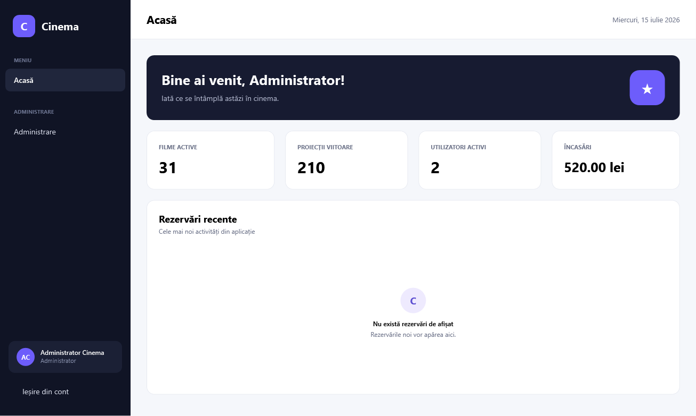
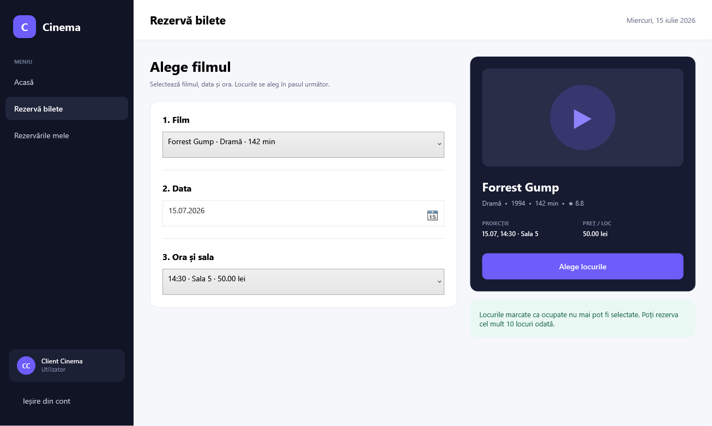

# Cinema

Aplicație desktop pentru administrarea unui cinema și rezervarea biletelor. Proiectul oferă fluxuri separate pentru clienți și administratori, păstrează datele aplicației inițiale și folosește SQL Server Express ca sursă centrală de date.

## Interfață

| Panou administrator | Rezervare bilete |
|---|---|
|  |  |

## Funcționalități

### Client

- creare cont și autentificare;
- alegere film, dată, oră și sală disponibilă;
- hartă vizuală a locurilor, cu locurile ocupate blocate;
- rezervare tranzacțională, fără dublarea unui loc;
- bilet cu un cod unic;
- vizualizarea și anularea rezervărilor viitoare.

### Administrator

- panou cu statistici, încasări și rezervări recente;
- administrarea filmelor, sălilor, programărilor și prețurilor;
- administrarea actorilor și utilizatorilor;
- schimbarea rolului, activarea conturilor și resetarea parolelor;
- consultarea și anularea rezervărilor;
- acces la datele importate din vechea bază SQLite.

## Tehnologii

- .NET 8 și WPF;
- SQL Server Express și `Microsoft.Data.SqlClient`;
- autentificare Windows pentru conexiunea locală;
- parole protejate cu PBKDF2-SHA256, salt individual și 120.000 de iterații;
- SQLite folosit exclusiv pentru importul datelor proiectului vechi.

## Cerințe

- Windows 10 sau Windows 11;
- [.NET 8 SDK](https://dotnet.microsoft.com/download/dotnet/8.0) pentru dezvoltare sau .NET 8 Desktop Runtime pentru rularea variantei publicate;
- SQL Server Express cu instanța `\.\SQLEXPRESS`;
- SQL Server Management Studio, opțional, pentru administrarea vizuală a bazei de date.

## Pornire după clonare

1. Pornește serviciul `SQL Server (SQLEXPRESS)`.
2. Deschide un terminal în folderul proiectului.
3. Restaurează și pornește aplicația:

```powershell
dotnet restore .\Cinema.sln
dotnet run --project .\Cinema\Cinema.csproj
```

La prima pornire, aplicația creează automat baza de date, tabelele, conturile inițiale, filmele, sălile, actorii și programul pentru următoarele 21 de zile. Tot atunci sunt importate o singură dată datele păstrate în `LegacyData/CinemaDB.sqlite`.

## Conturi inițiale

| Rol | Utilizator | Parolă |
|---|---|---|
| Administrator | `admin` | `Admin123!` |
| Client | `user` | `User123!` |

După prima autentificare, parola administratorului trebuie schimbată din `Administrare > Utilizatori`.

## Baza de date și SSMS

Conexiunea implicită este definită în `Cinema/Data/SqlConnectionFactory.cs`:

```text
Server=.\SQLEXPRESS;Database=CinemaModernDB;Integrated Security=True;TrustServerCertificate=True
```

În SSMS, conectarea se face la `\.\SQLEXPRESS` cu **Windows Authentication**, apoi baza poate fi găsită în `Databases > CinemaModernDB`.

Pentru inițializare manuală poate fi rulat scriptul `Database/CinemaModernDB.sql`. Scriptul nu șterge date și creează doar obiectele lipsă; datele inițiale sunt completate de aplicație.

## Compilare și verificare

```powershell
dotnet build .\Cinema.sln --configuration Release
.\Cinema\bin\Release\net8.0-windows\Cinema.exe --smoke-test
```

Verificarea automată validează schema, datele inițiale, autentificarea, paginile principale și un ciclu complet rezervare–anulare. Rezervarea creată pentru test este ștearsă la final.

Pentru o variantă locală gata de distribuit:

```powershell
dotnet publish .\Cinema\Cinema.csproj --configuration Release --output .\publish\Cinema
```

Folderul `publish` este generat local și nu este inclus în repository.

## Date păstrate

- 39 de filme și starea lor de disponibilitate;
- 10 săli și configurațiile lor;
- 12 actori;
- 9 bilete și 30 de locuri din baza SQLite inițială.

În baza veche, biletele aveau `FilmId=0` și `SalaId=0`. Pentru a nu crea legături incorecte, înregistrările sunt păstrate nemodificate în `dbo.LegacyTickets` și sunt vizibile administratorului în secțiunea **Date vechi importate**.

## Structura proiectului

```text
Cinema/
├── Data/          conexiune, inițializare și migrare
├── LegacyData/    baza SQLite folosită pentru import
├── Models/        entitățile aplicației
├── Repositories/  interogări parametrizate și tranzacții SQL
├── Services/      autentificare, parole și verificări
├── Styles/        tema vizuală WPF
└── Views/         ferestre și pagini
Database/          scriptul pentru SQL Server Management Studio
```

## Drepturi

Copyright © 2026. Toate drepturile rezervate. Nu este acordată o licență de redistribuire sau reutilizare prin simpla publicare a codului.
